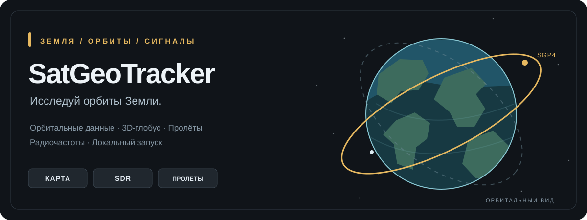

<div align="center">


# SatGeoTracker

**Исследуй орбиты Земли.**

Интерактивный 3D-трекер спутников с прогнозированием пролётов, радиоданными и визуализацией орбит.

<p>
  
  
  
</p>



**[Возможности](#возможности) · [Быстрый запуск](#быстрый-запуск) · [Архитектура](#архитектура) · [План развития](docs/ROADMAP.md) · [История изменений](CHANGELOG.md)**

</div>

## О проекте

**SatGeoTracker (SGT)** — веб-приложение для исследования искусственных спутников Земли на интерактивном 3D-глобусе. Оно получает орбитальные элементы из **CelesTrak**, рассчитывает положения по модели **SGP4** и отображает их с помощью **CesiumJS**.

В приложении объединены отслеживание спутников, точка наземного наблюдения, прогнозы пролётов и справочник передатчиков **SatNOGS DB**. Проект предназначен прежде всего для локального запуска, обучения и исследования.

> Координаты вычисляются по орбитальным элементам, а не поступают напрямую с борта спутников. Точность зависит от актуальности исходных данных.

## Возможности

| Режим | Функции |
| --- | --- |
| **КАРТА** | 3D-глобус, поиск по названию и NORAD ID, фильтры LEO/MEO/GEO, орбитальные траектории и слежение камерой. |
| **SDR** | Каталог спутниковых радиоканалов SatNOGS, фильтры частот, данные о передатчиках и оценка доплеровской поправки. |
| **ПРОЛЁТЫ** | Наземный наблюдатель, расчёт AOS/TCA/LOS, угла места, азимута и ближайших пролётов. |

**Доступно во всех режимах:**

- **Карточка наведения.** Название, NORAD ID, класс орбиты, высота и скорость спутника без изменения положения камеры; дополнительные сведения зависят от режима.
- **Избранное.** Сохранение объектов по NORAD ID, поиск, быстрый переход и хранение списка в браузере.
- **Камера и 3D.** Сопровождение спутника, траектории, модель МКС, отдельные маркеры станций, настройка угла обзора.
- **Graphite Glass.** Компактный графитовый интерфейс, янтарные маркеры, адаптивные панели и оригинальный логотип.

## Фотографии спутников (v0.9.2)

При выборе спутника в любом режиме (**КАРТА / SDR / ПРОЛЁТЫ**) приложение проверяет наличие изображения в SatNOGS DB по точному NORAD ID. При наличии фото рядом с названием показывается компактная миниатюра со ссылкой на источник. Отсутствие снимка не вызывает ошибок и не загружает весь каталог фотографий. Метаданные кешируются в FastAPI. Подробности — [Satellite Media](docs/SATELLITE_MEDIA.md).

## Быстрый запуск

**Требования:** Windows, Node.js с npm, Python 3. Для установки зависимостей и получения данных нужен интернет.

```powershell
git clone https://github.com/CactusDex/SatGeoTracker.git
cd SatGeoTracker
.\setup.cmd
.\dev.cmd
```

После запуска открой **http://127.0.0.1:5173/**. API доступен на **http://127.0.0.1:8000/**.

Для остановки используй `stop-dev.cmd`. Подробнее — в [документации по запуску](docs/DEVELOPMENT.md).

## Архитектура

```text
CelesTrak OMM ──┐
                ├── FastAPI и кеш ── React / TypeScript
SatNOGS DB ─────┘                         │
                                       SGP4
                                         │
                                     CesiumJS
                                         │
                             Карта · Пролёты · SDR
```

| Подсистема | Технологии |
| --- | --- |
| Интерфейс | React 19, TypeScript, Vite |
| Визуализация Земли | CesiumJS |
| Расчёт орбит | satellite.js / SGP4 |
| API и кеш | Python, FastAPI |
| Орбитальные элементы | CelesTrak GP / OMM |
| Радиоданные | SatNOGS DB |
| 3D-модель МКС | NASA |

Отдельная база данных не требуется: избранное и координаты наблюдателя хранятся в браузере, а сервер кеширует внешние данные.

## Проверки и ограничения

```powershell
cd frontend
npm run test:all
npm run check:cesium
```

Для v0.9.2 **41 из 41 Frontend-тестов пройдены**; основные функции проверены в браузере.

**Известное ограничение:** production-сборка `npm run build` на Windows ранее завершалась ошибкой совместимости `satellite.js` (WASM) и сборщика Vite Worker. В репозитории настроен формат ES-модулей для Workers, но успешная сборка пока не подтверждена. Независимая численная сверка SGP4 также запланирована.

## Документация

- [План развития](docs/ROADMAP.md) и [история изменений](CHANGELOG.md)
- [Архитектура](docs/ARCHITECTURE.md) · [Разработка](docs/DEVELOPMENT.md)
- [Наблюдатель и пролёты](docs/OBSERVER_PASSES.md) · [3D-модели](docs/MODELS.md)
- [Независимая проверка расчётов](scripts/INDEPENDENT_AUDIT.md)

## Автор и источники

**Автор — [Cactus Dex](https://github.com/CactusDex).**

Данные: [CelesTrak](https://celestrak.org/) (орбиты), [SatNOGS DB](https://db.satnogs.org/) (радиоканалы), [NASA](https://science.nasa.gov/3d-resources/) (3D-ресурсы МКС).

Расчётные траектории зависят от актуальности элементов орбиты. Наличие частоты в справочнике не гарантирует приём радиосигнала.

---

<div align="center"><sub>SatGeoTracker · Земля / Орбиты / Сигналы · v0.9.2</sub></div>
